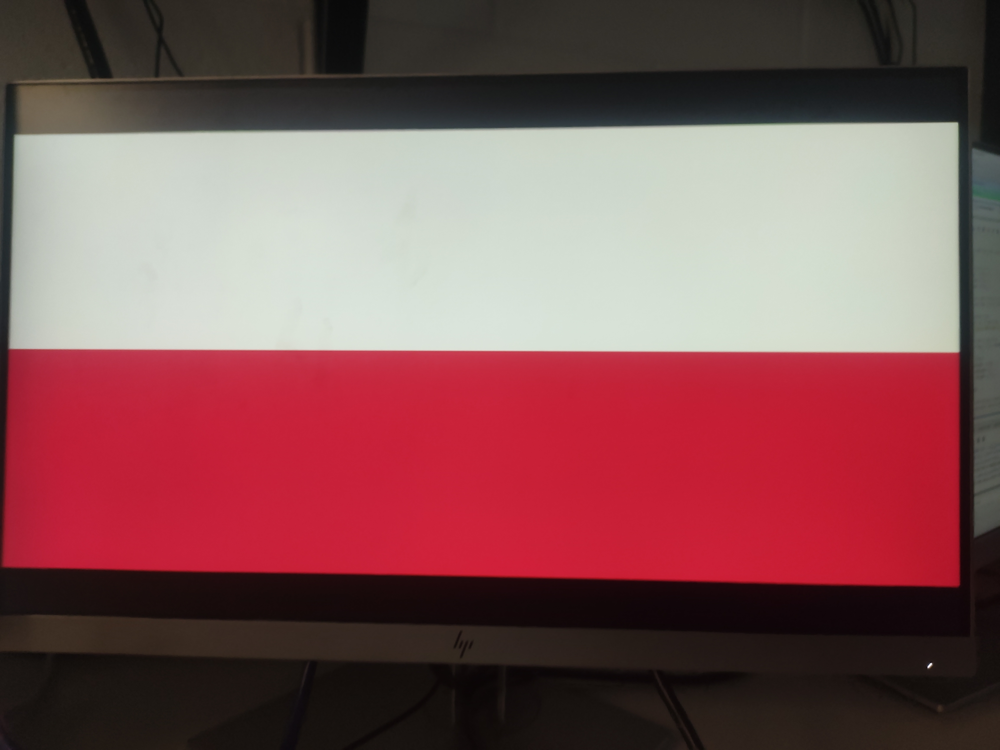
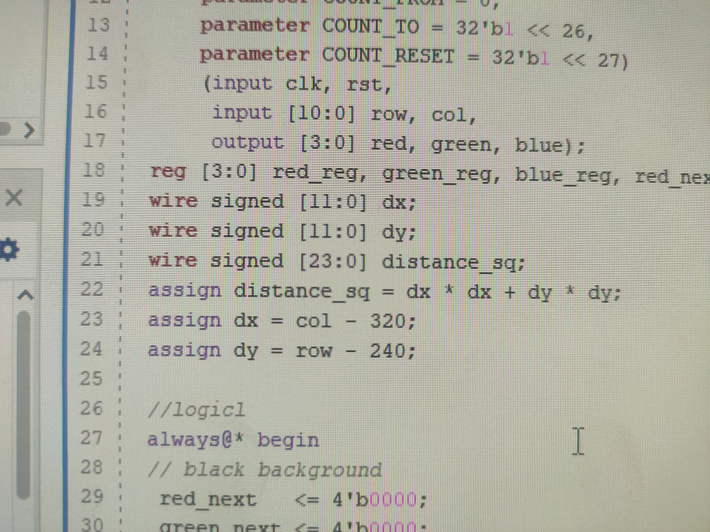

# **FPGA-VGA-VERILOG**
Hello My name is Billy Lis-Murphy and this is my vga verilog porject

### **Project Set-Up**
The was set up using Vivado. The board being used is the xc7a35tcpg236-1. We were given some template code to put into the project to start with.

### **Template Code**

The template code had a constraints file to set up the VGA output and reset switch on the board, Test bench file to ensure the code can run on the board without failing, and 4 design source files.
The First design source file, VGATop, acts as a manager connecting the other 3 design source files. The second file is a clock that runs at 100 MHz. The third file, vga_sync, defines the screen dimensions. The final file, colour_strips, defines what is drawn onto the screen.

### **Simulation**
Explain the simulation process. Reference any important details, include a well-selected screenshot of the simulation. Guideline: 1/2 short paragraphs.
### **Synthesis**
Describe the synthesis and implementation processes. Consider including 1/2 useful screenshot(s). Guideline: 1/2 short paragraphs.
### **Demonstration**
Perhaps add a picture of your demo. Guideline: 1/2 sentences.

## **My VGA Design Edits**
I had two main stages to my design ideas, first, to replicated the flags of two countries, Ireland and Poland, and the second stage was to try and make a face.
The flags wouldn't be complex as it would be just minor adjustments to the code we were given while the face would be more complex, having to use circles.
The flag of Ireland specification where gotten from [Here](https://web.archive.org/web/20200213202756/https://assets.gov.ie/2949/151118153516-096a94ba6955435cae965414f7667104.pdf), a way back machine archive of an official government document.
for the Polish flag depiction, I got my source from [Wikipedia](https://en.wikipedia.org/wiki/Flag_of_Poland), which claims its depiction of the flag from the Constitution of the Republic of Poland from 1997 found [here](https://isap.sejm.gov.pl/isap.nsf/DocDetails.xsp?id=WDU19970780483). I took if from Wikipedia because I don't know how to read polish.
### **Code adaptation for flags**
Adapting the code for the flags was simple, For the flag of Ireland, I reduced the number of columns from 8 to 3, while increasing the width of each column to fit the screen. To ensure the flag was the correct shape, I did calculated the relationship between the between the screen the image was displayed on and the output resolution of the board and scaled the aspect ratio of the flag using this number, I did the same for the Polish flag.

For Adapting the code for the Polish flag had a slight bit more bit more to do, I reduced the number of columns from 3 to 2, and changed the coded from checking for columns to checking for which row it was on, this made the stripes horizontal instead of vertical.
### **Simulation**
Show how you simulated your own design. Are there any things to note? Demonstrate your understanding. Add a screenshot. Guideline: 1-2 short paragraphs.
### **Synthesis**
Describe the synthesis & implementation outputs for your design, are there any differences to that of the original design? Guideline 1-2 short paragraphs.
### **Demonstration**
Flag of Ireland

Flag of Poland

### **Code Adaptation for the face**
This code adaptation was more complex than the flags, first was learning how to draw the circles on the screen. I was given a code template that described how to draw a circle.

I adjusted the code to make it form this eye.

I then made a second eye and adjusted their positions to be in location for the face I did this be changing the row and column offset that are used in the code for dx and dy, for  eye1 and eye2.

I defined the mouth using nested if statements, the first one to define the width using columns, and the second using rows to define the height of the mouth using rows

### **Simulation**
Show how you simulated your own design. Are there any things to note? Demonstrate your understanding. Add a screenshot. Guideline: 1-2 short paragraphs.
### **Synthesis**
Describe the synthesis & implementation outputs for your design, are there any differences to that of the original design? Guideline 1-2 short paragraphs.
### **Demonstration**
If you get your own design working on the Basys3 board, take a picture! Guideline: 1-2 sentences.
## **More Markdown Basics**
This is a paragraph. Add an empty line to start a new paragraph.

Font can be emphasised as *Italic* or **Bold**.

Code can be highlighted by using `backticks`.

Hyperlinks look like this: [GitHub Help](https://help.github.com/).

A bullet list can be rendered as follows:
- vectors
- algorithms
- iterators

Images can be added by uploading them to the repository in a /docs/assets/images folder, and then rendering using HTML via githubusercontent.com as shown in the example below.

