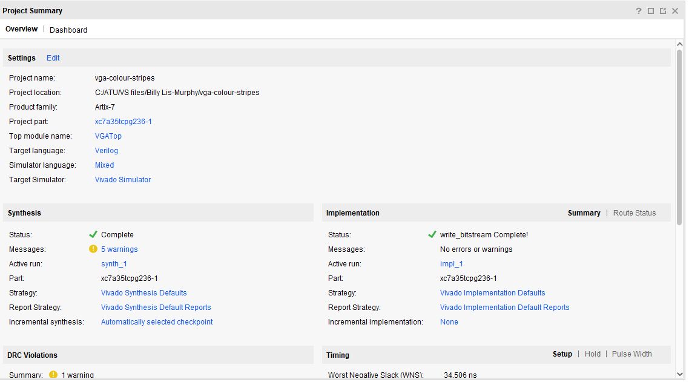
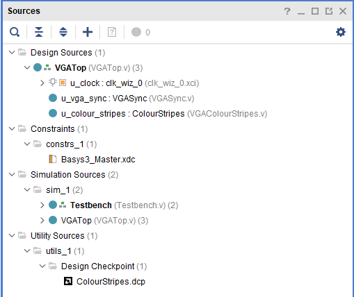
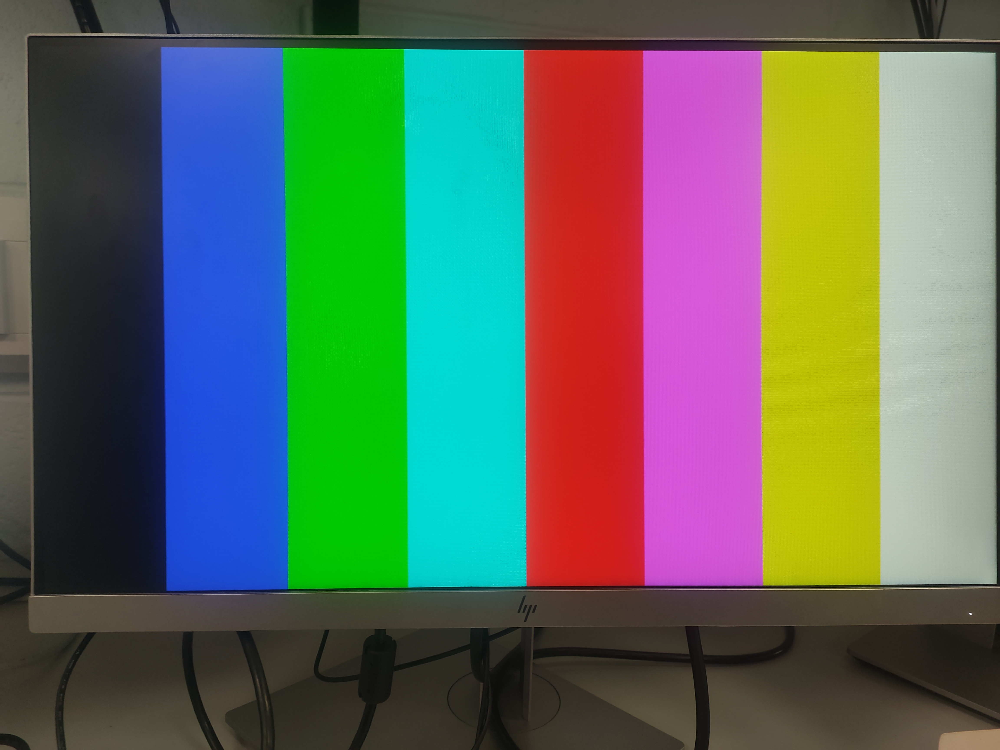
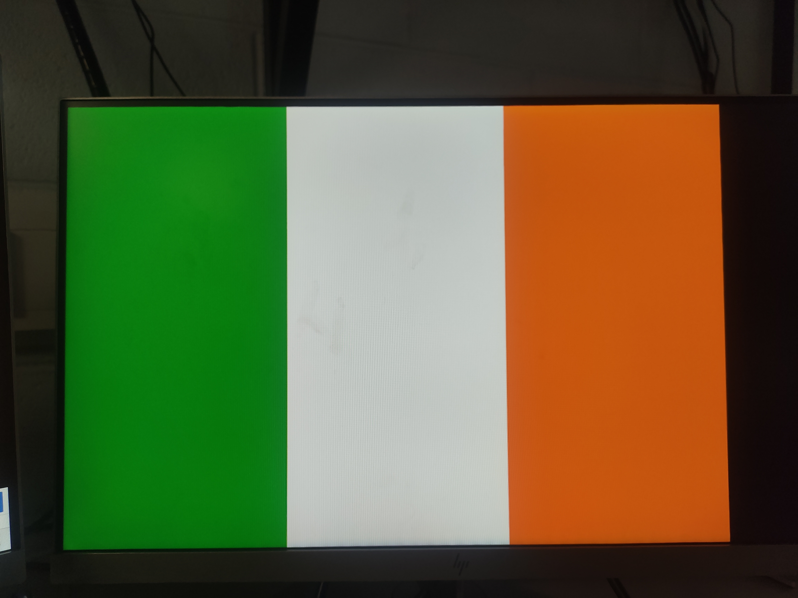
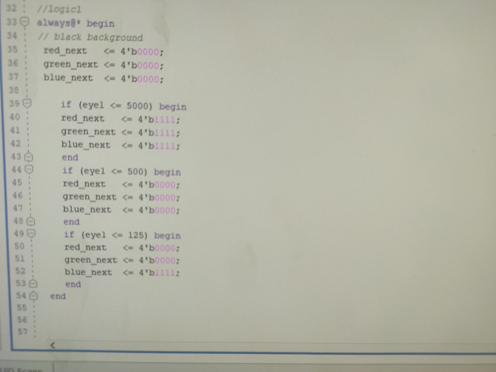
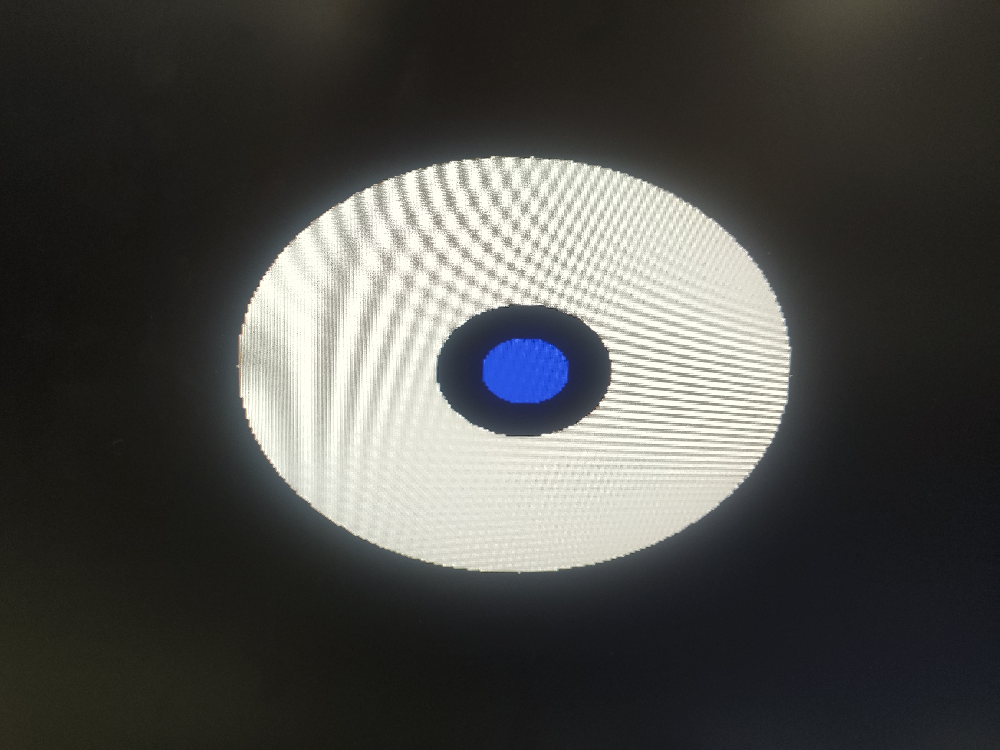
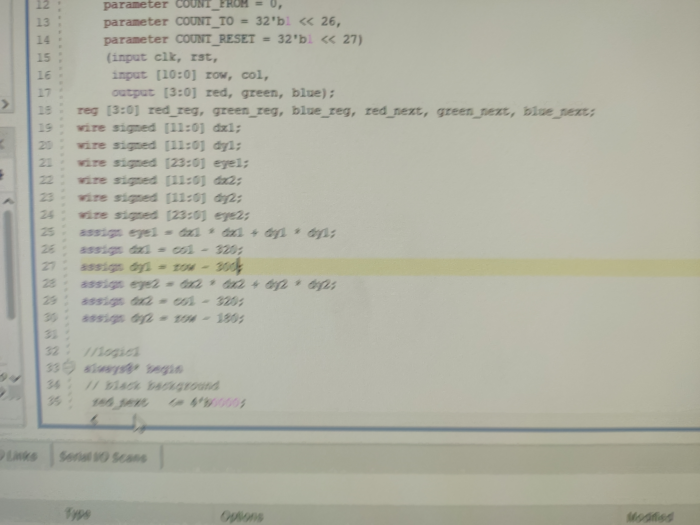
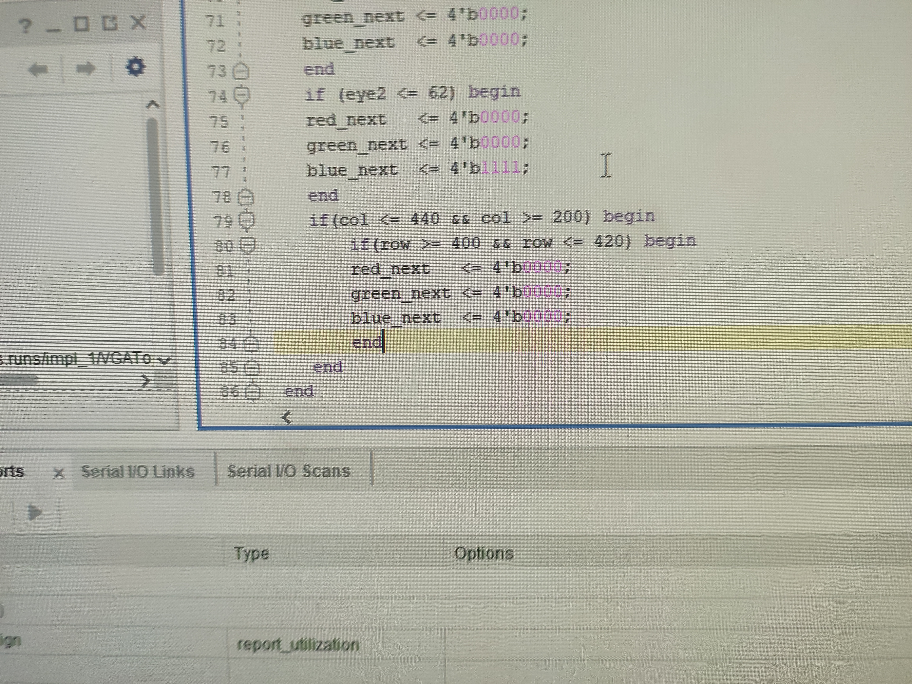
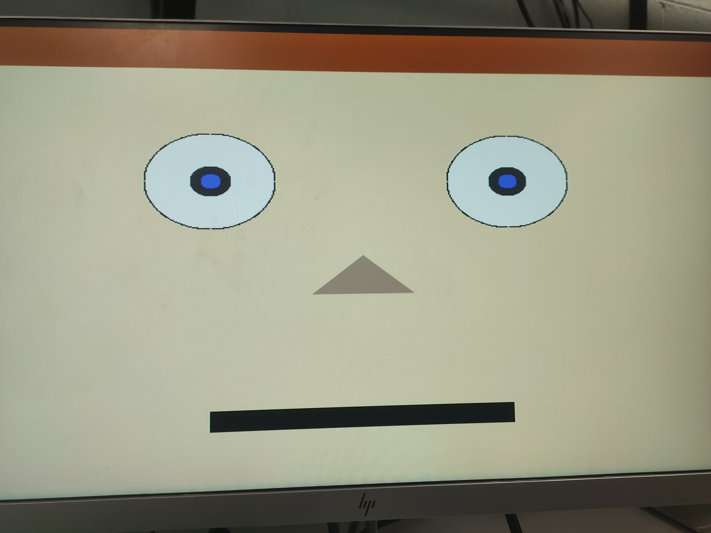

# **FPGA-VGA-VERILOG**
Hello My name is Billy Lis-Murphy and this is my vga verilog porject

### **Project Set-Up**
The was set up using Vivado. The board being used is the xc7a35tcpg236-1. We were given some template code to put into the project to start with.

### **Template Code**

The template code had a constraints file to set up the VGA output and reset switch on the board, Test bench file to ensure the code can run on the board without failing, and 4 design source files.
The First design source file, VGATop, acts as a manager connecting the other 3 design source files. The second file is a clock that runs at 100 MHz. The third file, vga_sync, defines the screen dimensions. The final file, colour_strips, defines what is drawn onto the screen.

### **Simulation**

This simulation demonstrates the changing of the red_next, green_next, blue_next.
### **Synthesis**

this image shows the the implementation design that will be on the board, the parts in blue highlight the registers that hold the data on the board and logic gates that are being used, while highlighted in orange, are the output pins and output buffers, that send the data to the screen to be displayed
### **Demonstration**

Here we can see the columns of different colours

## **My VGA Design Edits**
I had two main stages to my design ideas, first, to replicated the flags of two countries, Ireland and Poland, and the second stage was to try and make a face.
The flags wouldn't be complex as it would be just minor adjustments to the code we were given while the face would be more complex, having to use circles.
The flag of Ireland specification where gotten from [Here](https://web.archive.org/web/20200213202756/https://assets.gov.ie/2949/151118153516-096a94ba6955435cae965414f7667104.pdf), a way back machine archive of an official government document.
for the Polish flag depiction, I got my source from [Wikipedia](https://en.wikipedia.org/wiki/Flag_of_Poland), which claims its depiction of the flag from the Constitution of the Republic of Poland from 1997 found [here](https://isap.sejm.gov.pl/isap.nsf/DocDetails.xsp?id=WDU19970780483). I took if from Wikipedia because I don't know how to read polish.
### **Code adaptation for flags**
Adapting the code for the flags was simple, For the flag of Ireland, I reduced the number of columns from 8 to 3, while increasing the width of each column to fit the screen. To ensure the flag was the correct shape, I did calculated the relationship between the between the screen the image was displayed on and the output resolution of the board and scaled the aspect ratio of the flag using this number, I did the same for the Polish flag.

For Adapting the code for the Polish flag had a slight bit more bit more to do, I reduced the number of columns from 3 to 2, and changed the coded from checking for columns to checking for which row it was on, this made the stripes horizontal instead of vertical.
### **Simulation**
same simulation test as before
### **Synthesis**

Here we can see the implementation design for the flag. Comparing it to the implementation design from the template code, we see less registers and logic gates being used, this makes sense as there are less if statements in use.
### **Demonstration**
Flag of Ireland

Flag of Poland

### **Code Adaptation for the face**
This code adaptation was more complex than the flags, first was learning how to draw the circles on the screen. I was given a code template that described how to draw a circle. The circle is defined by describing the center point and measuring the distance from that point. The signed dy and dx are offset from the current column and row., this defines the center of the circle. Then the length formula is used to get the square of distance. the if statement in the always loop defines the size of the circle, in this case eye1 is in place of distance_sq seen in the first picture.

I adjusted the code to make it form this eye.

I then made a second eye and adjusted their positions to be in location for the face I did this be changing the row and column offset that are used in the code for dx and dy, for  eye1 and eye2.

from line 93 to 100, I defined the mouth using nested if statements, the first one to define the width using columns, and the second using rows to define the height of the mouth using rows

The nose is is defined using from lines 96 to 102. It uses nested if statements but this time, the row is the first if and column is the second, and row affects the column. The first if statement functions the same as for the mouth but the second if statement works differently. The if statement describes a line, from one end to the other, where the length is dependent on the row, so the lower on the screen the row is, is longer the line it draws, converging at row 240.

### **Simulation**
same simulation test as before
### **Synthesis**

Here we see the implementation design for the face. As we can see there are more registers and logic gates in use, which is understandable given all the registers used for the circle code and if statements to define the moutn and nose.
### **Demonstration**

This is the final face.
